<a id="top"></a>

# 🎨 Theme Guide

<!-- dev-banner -->
> [!NOTE]
> This is the documentation of the development branch: it may describe
> options not released yet. For the latest release, see the [documentation site](https://francois-le-ko4la.github.io/lovelace-test/).
<!-- /dev-banner -->

Color is what turns a bar into an answer: green means all is well, red means
look now. This page shows every way to get there, from one line of YAML to a
fully restyled card. Start at the top and stop as soon as you have what you
need.

- **[Pick a ready-made theme](#predefined-theme).** One line, `theme: <value>`,
  and the bar changes color with the value: a battery, a CPU, a temperature...
- **[Draw your own zones](#custom-theme).** Red under 20 %, green up to 80 %:
  `custom_theme` sets the limits you want. [`bar_color_mode`](#bar_color_mode)
  then chooses how the zones are painted: one solid color, blocks or a gradient.
- **[Choose a color by name](#token-color).** No zones needed: `bar_color: red`
  paints the bar, `color: red` the icon. Any name like `red` or `teal` works,
  matched to your Home Assistant theme, or any CSS color.
- **[Restyle the whole card](#css)** _(advanced)_. CSS variables change the
  bar's background, the icon's shape, the markers... in a Home Assistant theme
  or with card_mod. The [card structure](#card-mod-and-card-structure) gives
  the selectors.
- **[Size the card](#card-sizing).** How the card picks its height in a
  Sections or Masonry view, a stack, a grid or a button-card, and how to
  change it.
- **Something looks wrong?** Nothing is broken: remove the lines you added and
  save, the card goes back to its default look. A bar in a single color is
  normal without `theme` or `custom_theme`. For an error message on the card,
  see [Troubleshooting](troubleshooting.md).

## Predefined theme

The card's built-in color-zone presets, set with one line, `theme: <value>`.
They are not Home Assistant themes. They work on every kind of card: the card,
the badge, the tile feature, the templates and each row of a multi-card.

Under each picture, **Show ranges** gives the limits of each color and
**Show YAML** the lines to copy: paste them in the card's code editor (**Show
code editor** in the card editor), then replace the `entity:` value with your
own. Want your own limits, e.g. red under 20 %? See
[Custom theme](#custom-theme).

| Value                                                      | Use for                          | Unit  |
| :--------------------------------------------------------- | :------------------------------- | :---- |
| [`battery_adaptive`](#battery-adaptive)                    | Phone or laptop battery          | %     |
| [`critical_when_low`](#critical-low)                       | Battery, stock                   | %     |
| [`optimal_when_low`](#optimal-low)                         | Lower is better                  | %     |
| [`critical_when_high`](#critical-high)                     | CPU, RAM, disk usage             | %     |
| [`optimal_when_high`](#optimal-high)                       | Higher is better                 | %     |
| [`critical_when_extreme`](#critical-extreme)               | Tank level, deviation            | %     |
| [`critical_when_extreme_center`](#critical-extreme-center) | Signed deviation (`center_zero`) | %     |
| [`light`](#light)                                          | Brightness                       | %     |
| [`temperature`](#temperature)                              | Temperature                      | °C    |
| [`humidity`](#humidity)                                    | Humidity                         | %     |
| [`voc`](#voc)                                              | Air quality (VOC)                | ppb   |
| [`pm25`](#pm25)                                            | Air quality (PM 2.5)             | µg/m³ |

> [!NOTE]
>
> Most themes work in `%`. Three use real units: `temperature`, `voc` and
> `pm25`. For these, `theme: voc` alone is enough: the card picks the scale from
> the theme's zones. Defaults when `min_value`/`max_value` are not set:
>
> | Theme                          | `min_value`             | `max_value`              |
> | :----------------------------- | :---------------------- | :----------------------- |
> | In `%`                         | `0`                     | `100`                    |
> | `temperature`, `voc`, `pm25`   | `0`                     | the highest zone bound   |
> | Same, with `center_zero`       | the lowest zone bound   | the highest zone bound   |
>
> See [`max_value`](configuration.md#max_value) to override them.

<a id="battery-adaptive"></a>

### Battery, adapts to charging (`battery_adaptive`)

<picture>
  <source media="(prefers-color-scheme: dark)"
    srcset="images/theme-battery-adaptive-dark-9509c1.png">
  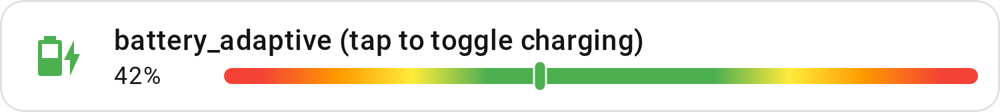
</picture>

Use this for a phone or laptop battery. While charging, the bar turns red when
the battery is too full: it follows `critical_when_extreme`, since a battery
ages faster when kept at 100 %, so 30–70 % is the safe zone. Unplugged, it
follows `critical_when_low`: only a low battery is red.

The card detects charging the same way as
`icon_animation: battery_charging`: from an attribute, the state, or another
entity of the same device.

<br />
<details>
<summary>Show YAML</summary>

```yaml
type: custom:entity-progress-card
entity: sensor.phone_battery_level
theme: battery_adaptive
```

</details>
<br />

> [!NOTE]
>
> The icon is automatically retrieved from the entity but can be overridden
> using the `icon` parameter.

[🔼 Back to top]

<a id="critical-low"></a>

### Critical when low (`critical_when_low`)

<picture>
  <source media="(prefers-color-scheme: dark)"
    srcset="images/theme-critical-low-dark-dbf8b1.png">
  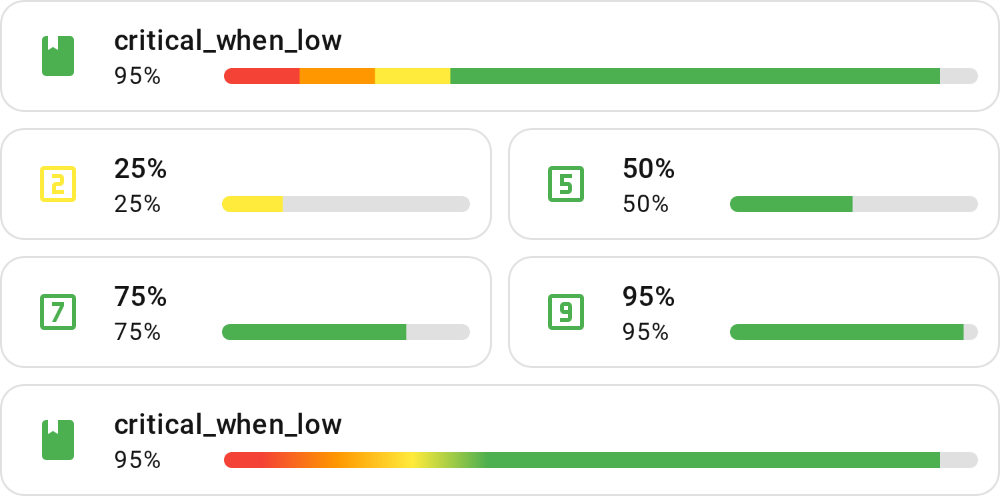
</picture>

The "Critical when Low" theme targets values that only become a problem near
zero, and are otherwise fine across a wide range - a battery level, for
instance. Unlike `optimal_when_high`, the bands are not evenly split: they
narrow sharply near zero to give more warning as the value approaches critical,
and stay broadly "green" everywhere else.

<br />
<details>
<summary>Show YAML</summary>

```yaml
type: custom:entity-progress-card
entity: sensor.phone_battery_level
theme: critical_when_low
```

</details>

<details>
<summary>Show ranges</summary>

| **Percentage Range** | **Color** | **Description** _(optional)_ |
| :------------------- | :-------- | :--------------------------- |
| 0% – 10%             | `red`     | Critical                     |
| 10% – 20%            | `orange`  | Low                          |
| 20% – 30%            | `yellow`  | Watch                        |
| 30% – 100%           | `green`   | Fine                         |

</details>
<br />

> [!NOTE]
>
> The icon is automatically retrieved from the entity but can be overridden
> using the `icon` parameter.

[🔼 Back to top]

<a id="optimal-low"></a>

### Optimal when low (`optimal_when_low`)

<picture>
  <source media="(prefers-color-scheme: dark)"
    srcset="images/theme-optimal-low-dark-c676a3.png">
  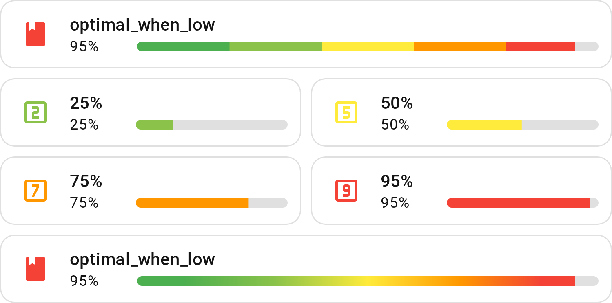
</picture>

The "Optimal when Low" parameter is particularly valuable for monitoring systems
or components that perform best when their values are at a lower level. For
example, in the case of memory usage or CPU load, lower values often indicate
that the system is running efficiently and not overburdened.

<br />
<details>
<summary>Show YAML</summary>

```yaml
type: custom:entity-progress-card
entity: sensor.system_monitor_cpu_usage
theme: optimal_when_low
```

</details>

<details>
<summary>Show ranges</summary>

| **Percentage Range** | **Color**     | **Description** _(optional)_ |
| :------------------- | :------------ | :--------------------------- |
| 0% – 20%             | `green`       | Low level / Safe             |
| 20% – 40%            | `light-green` | Good                         |
| 40% – 60%            | `yellow`      | Moderate                     |
| 60% – 80%            | `orange`      | Elevated                     |
| 80% – 100%           | `red`         | High / Critical              |

</details>
<br />

> [!NOTE]
>
> The icon is automatically retrieved from the entity but can be overridden
> using the `icon` parameter.

[🔼 Back to top]

<a id="critical-high"></a>

### Critical when high (`critical_when_high`)

<picture>
  <source media="(prefers-color-scheme: dark)"
    srcset="images/theme-critical-high-dark-a473f3.png">
  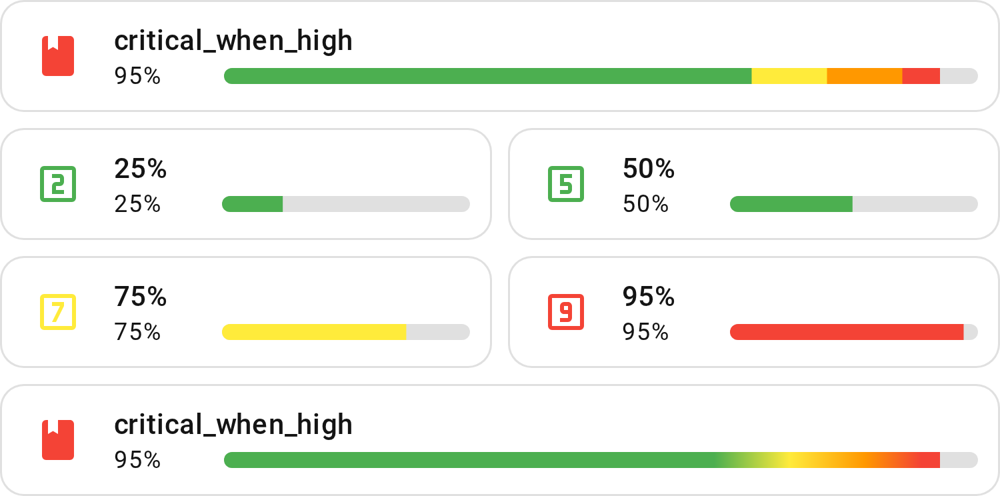
</picture>

The mirror of `critical_when_low`: a metric that is fine across a wide low range
and only becomes a problem near 100% - CPU load, RAM or disk usage, for
instance. The bands narrow sharply near the top instead of the bottom.

<br />
<details>
<summary>Show YAML</summary>

```yaml
type: custom:entity-progress-card
entity: sensor.system_monitor_cpu_usage
theme: critical_when_high
```

</details>

<details>
<summary>Show ranges</summary>

| **Percentage Range** | **Color** | **Description** _(optional)_ |
| :------------------- | :-------- | :--------------------------- |
| 0% – 70%             | `green`   | Fine                         |
| 70% – 80%            | `yellow`  | Watch                        |
| 80% – 90%            | `orange`  | High                         |
| 90% – 100%           | `red`     | Critical                     |

</details>
<br />

> [!NOTE]
>
> The icon is automatically retrieved from the entity but can be overridden
> using the `icon` parameter.

[🔼 Back to top]

<a id="optimal-high"></a>

### Optimal when high (`optimal_when_high`)

<picture>
  <source media="(prefers-color-scheme: dark)"
    srcset="images/theme-optimal-high-dark-95f174.png">
  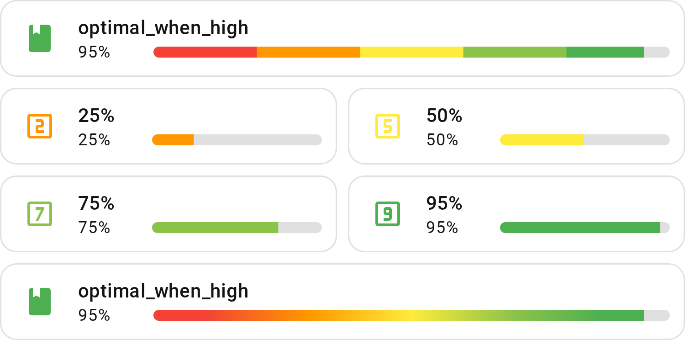
</picture>

The "Optimal when High" parameter is particularly useful in cases where the
system or component in question performs best at higher values. For instance, in
the case of battery charge, the device functions more efficiently and with
better performance when the battery level is high. By using "Optimal when High,"
you can set a theme that visually emphasizes and prioritizes states where the
value is at its peak.

<br />
<details>
<summary>Show YAML</summary>

```yaml
type: custom:entity-progress-card
entity: sensor.phone_battery_level
theme: optimal_when_high
```

</details>

<details>
<summary>Show ranges</summary>

| **Percentage Range** | **Color**     | **Description** _(optional)_ |
| :------------------- | :------------ | :--------------------------- |
| 0% – 20%             | `red`         | Critical / Very low          |
| 20% – 40%            | `orange`      | Low                          |
| 40% – 60%            | `yellow`      | Moderate                     |
| 60% – 80%            | `light-green` | Good                         |
| 80% – 100%           | `green`       | Optimal / High               |

</details>
<br />

> [!NOTE]
>
> The icon is automatically retrieved from the entity but can be overridden
> using the `icon` parameter.

[🔼 Back to top]

<a id="critical-extreme"></a>

### Critical when extreme (`critical_when_extreme`)

<picture>
  <source media="(prefers-color-scheme: dark)"
    srcset="images/theme-critical-extreme-dark-c8644b.png">
  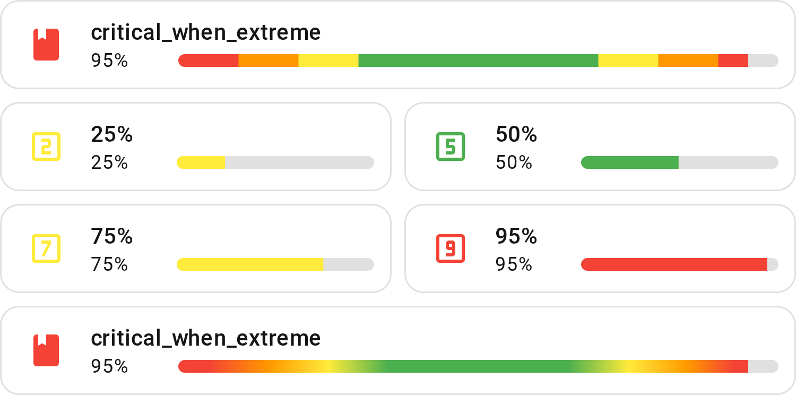
</picture>

The combination of `critical_when_low` and `critical_when_high`: both ends of
the range are a problem, and the middle is a wide, comfortable "green" band - a
tank level (too empty or too full), or a deviation from a target/setpoint (pairs
well with `center_zero`), for instance.

<br />
<details>
<summary>Show YAML</summary>

```yaml
type: custom:entity-progress-card
entity: sensor.water_tank_level
theme: critical_when_extreme
```

</details>

<details>
<summary>Show ranges</summary>

| **Percentage Range** | **Color** | **Description** _(optional)_ |
| :------------------- | :-------- | :--------------------------- |
| 0% – 10%             | `red`     | Critical                     |
| 10% – 20%            | `orange`  | Low                          |
| 20% – 30%            | `yellow`  | Watch                        |
| 30% – 70%            | `green`   | Fine                         |
| 70% – 80%            | `yellow`  | Watch                        |
| 80% – 90%            | `orange`  | High                         |
| 90% – 100%           | `red`     | Critical                     |

</details>
<br />

> [!NOTE]
>
> The icon is automatically retrieved from the entity but can be overridden
> using the `icon` parameter.

[🔼 Back to top]

<a id="critical-extreme-center"></a>

### Critical when extreme, centered (`critical_when_extreme_center`)

<picture>
  <source media="(prefers-color-scheme: dark)"
    srcset="images/theme-critical-extreme-center-dark-466609.png">
  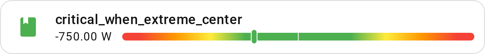
</picture>

`critical_when_extreme`'s own shape, but built for
[`center_zero`](configuration.md#center_zero) specifically: one continuous scale
from -100% to 100% instead of the same 0-100% zones mirrored onto each arm —
safe (green) sits at the center (zero), danger (red) at both ends, whichever
direction the value swings. A net power flow (charging/discharging), or a
deviation from a target/setpoint that can go either way, for instance.

<br />
<details>
<summary>Show YAML</summary>

```yaml
type: custom:entity-progress-card
entity: sensor.battery_power_flow
center_zero: true
theme: critical_when_extreme_center
```

</details>

<details>
<summary>Show ranges</summary>

| **Percentage Range** | **Color** | **Description** _(optional)_ |
| :------------------- | :-------- | :--------------------------- |
| -100% – -80%         | `red`     | Critical                     |
| -80% – -60%          | `orange`  | Low                          |
| -60% – -40%          | `yellow`  | Watch                        |
| -40% – 40%           | `green`   | Fine (centered on zero)      |
| 40% – 60%            | `yellow`  | Watch                        |
| 60% – 80%            | `orange`  | High                         |
| 80% – 100%           | `red`     | Critical                     |

</details>
<br />

> [!NOTE]
>
> The icon is automatically retrieved from the entity but can be overridden
> using the `icon` parameter. Outside `center_zero`, this theme still works but
> only shows its own 0%–100% half (the same shape `critical_when_extreme`
> already covers more fully) — pick the plain `critical_when_extreme` instead
> for a non-`center_zero` card.

[🔼 Back to top]

<a id="light"></a>

### Light (`light`)

<picture>
  <source media="(prefers-color-scheme: dark)"
    srcset="images/theme-light-dark-d902d7.png">
  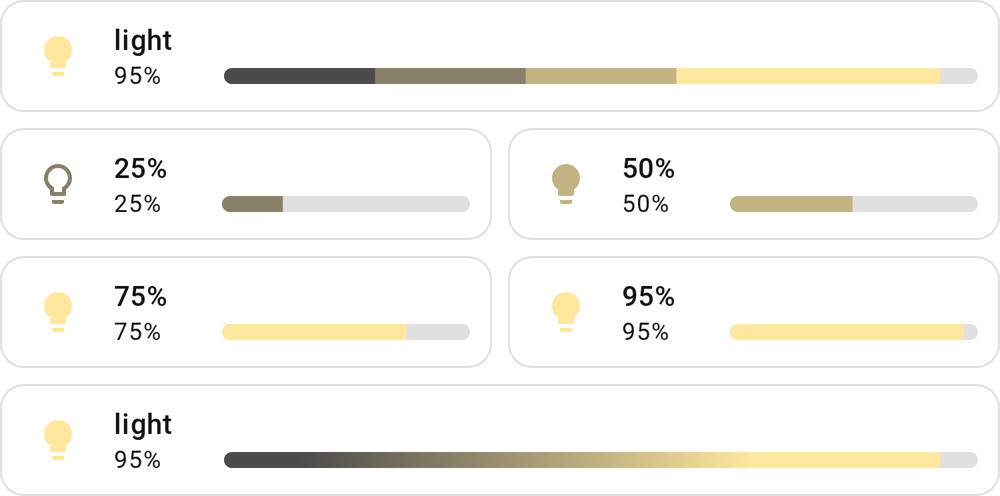
</picture>

The `light` configuration, designed by
[@harmonie-durrant](https://github.com/harmonie-durrant), defines how different
brightness levels are visually represented using colors and icons. This system
uses a **linear gradient**, meaning the color transitions smoothly across the
brightness percentage range. The `mdi:lightbulb-outline` icon is used for lower
brightness levels, while `mdi:lightbulb` is displayed when the light intensity
increases - thanks to the **linear** approach, the brightness smoothly
transitions between these levels.

<br />
<details>
<summary>Show YAML</summary>

```yaml
type: custom:entity-progress-card
entity: light.bandeau_led
attribute: brightness
theme: light
icon_tap_action:
  action: more-info
```

</details>

<details>
<summary>Show ranges</summary>

| **Brightness Level** | **Color Code** | **Description**    | **Icon**                |
| :------------------- | :------------- | :----------------- | :---------------------- |
| < 25%                | `#4B4B4B`      | Dim light          | `mdi:lightbulb-outline` |
| ≥ 25%                | `#877F67`      | Soft warm light    | `mdi:lightbulb-outline` |
| ≥ 50%                | `#C3B382`      | Medium warm light  | `mdi:lightbulb`         |
| ≥ 75%                | `#FFE79E`      | Bright warm light  | `mdi:lightbulb`         |
| ≥ 100%               | `#FFE79E`      | Maximum brightness | `mdi:lightbulb`         |

</details>
<br />
[🔼 Back to top]


<a id="temperature"></a>

### Temperature (`temperature`)

<picture>
  <source media="(prefers-color-scheme: dark)"
    srcset="images/theme-temperature-dark-6d4d36.png">
  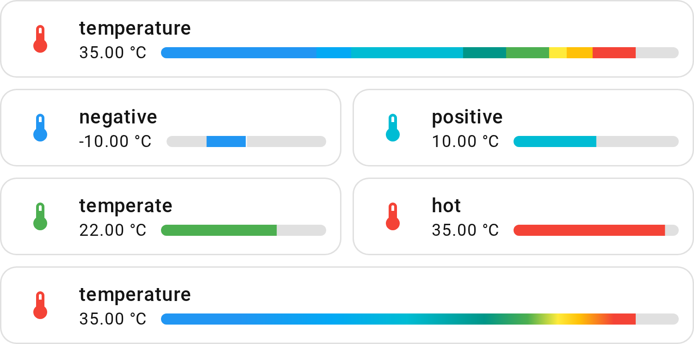
</picture>

`min_value` and `max_value` are optional: here they narrow the bar to
-20–45 °C instead of the theme's whole range.

<br />
<details>
<summary>Show YAML</summary>

```yaml
type: custom:entity-progress-card
entity: sensor.living_room_temperature
unit: °C
min_value: -20
max_value: 45
theme: temperature
icon_tap_action:
  action: more-info
```

</details>

<details>
<summary>Show ranges</summary>

| **Temperature Range (°C / °F)** | **Color Variable**        | **Description** |
| :------------------------------ | :------------------------ | :-------------- |
| -50°C – -20°C / -58°F – -4°F    | `var(--indigo-color)`     | Extremely cold  |
| -20°C – -2°C / -4°F – 28.4°F    | `var(--blue-color)`       | Very cold       |
| -2°C – 2°C / 28.4°F – 35.6°F    | `var(--light-blue-color)` | Cold            |
| 2°C – 15°C / 35.6°F – 59°F      | `var(--cyan-color)`       | Cool            |
| 15°C – 20°C / 59°F – 68°F       | `var(--teal-color)`       | Mild            |
| 20°C – 25°C / 68°F – 77°F       | `var(--green-color)`      | Optimal         |
| 25°C – 27°C / 77°F – 80.6°F     | `var(--yellow-color)`     | Warm            |
| 27°C – 30°C / 80.6°F – 86°F     | `var(--amber-color)`      | Hot             |
| 30°C – 100°C / 86°F – 212°F     | `var(--red-color)`        | Extremely hot   |

</details>
<br />

> [!IMPORTANT]
>
> Fahrenheit values are converted to apply the correct color. Make sure to set
> your unit to `°F` correctly in order to see the accurate color representation.

[🔼 Back to top]

<a id="humidity"></a>

### Humidity (`humidity`)

<picture>
  <source media="(prefers-color-scheme: dark)"
    srcset="images/theme-humidity-dark-40868c.png">
  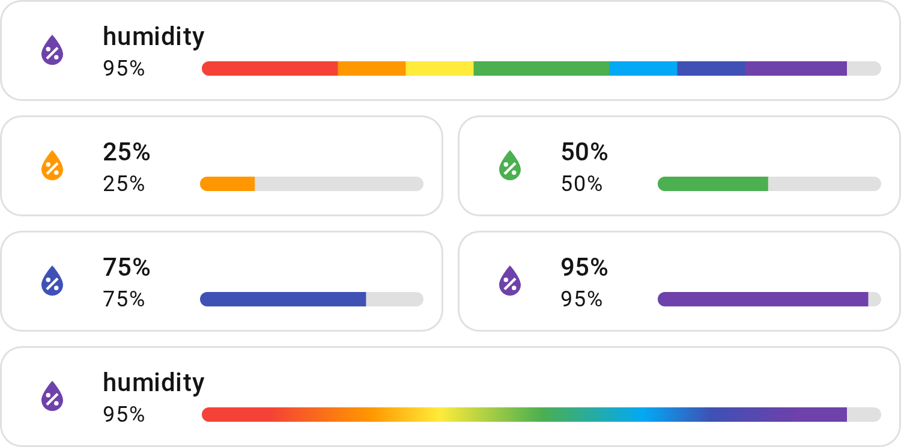
</picture>

The `humidity` configuration defines how different humidity levels are
represented with colors and icons. Unlike a linear gradient, this system uses
predefined humidity ranges, each associated with a specific color and icon.
Ranges are mirrored around the 40–60% comfort zone (10/10/10/20 on each side),
so the same distance from optimal gets a comparably-weighted color on either the
dry or humid end. Each range is visually represented using the
`mdi:water-percent` icon, ensuring a clear and intuitive display of humidity
levels.

<br />
<details>
<summary>Show YAML</summary>

```yaml
type: custom:entity-progress-card
entity: sensor.living_room_humidity
theme: humidity
icon_tap_action:
  action: more-info
```

</details>

<details>
<summary>Show ranges</summary>

| **Humidity Range** | **Color Variable**         | **Description**    |
| :----------------- | :------------------------- | :----------------- |
| 0% – 20%           | `var(--red-color)`         | Very dry air       |
| 20% – 30%          | `var(--orange-color)`      | Dry air            |
| 30% – 40%          | `var(--yellow-color)`      | Slightly dry air   |
| 40% – 60%          | `var(--green-color)`       | Optimal humidity   |
| 60% – 70%          | `var(--light-blue-color)`  | Slightly humid air |
| 70% – 80%          | `var(--indigo-color)`      | Humid air          |
| 80% – 100%         | `var(--deep-purple-color)` | Very humid air     |

</details>
<br />
[🔼 Back to top]


<a id="voc"></a>

### VOC (`voc`)

<picture>
  <source media="(prefers-color-scheme: dark)"
    srcset="images/theme-voc-dark-a31be6.png">
  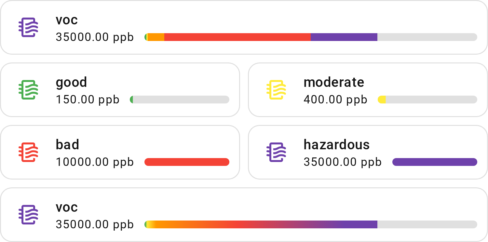
</picture>

The `voc` configuration defines how different levels of volatile organic
compounds (VOCs) are represented using colors and icons. Instead of a linear
gradient, this system categorizes VOC levels into predefined ranges, each
associated with a specific color for better visualization. Each range is
visually represented using the `mdi:air-filter` icon, ensuring a clear and
intuitive display of VOC levels.

<br />
<details>
<summary>Show YAML</summary>

```yaml
type: custom:entity-progress-card
entity: sensor.living_room_voc
unit: ppb
decimal: 0
max_value: 300
theme: voc
icon_tap_action:
  action: more-info
```

</details>

<details>
<summary>Show ranges</summary>

| **TVOC Range (ppb)** | **Color Variable**         | **Description**        |
| :------------------- | :------------------------- | :--------------------- |
| 0 – 300              | `var(--green-color)`       | Good air quality       |
| 300 – 500            | `var(--yellow-color)`      | Acceptable air quality |
| 500 – 3000           | `var(--orange-color)`      | Moderate air quality   |
| 3000 – 25,000        | `var(--red-color)`         | Poor air quality       |
| 25,000 – 50,000      | `var(--deep-purple-color)` | Hazardous              |

</details>
<br />

> [!IMPORTANT]
>
> The information provided in this HA card is based on thresholds from the
> following
> [source](https://support.getawair.com/hc/en-us/articles/19504367520023-Understanding-Awair-Score-and-Air-Quality-Factors-Measured-By-Awair-Element).
> This color code is for informational purposes only and should not be taken as
> professional advice or a standard to follow. It is crucial to consult the
> device's official documentation or current standards for the most accurate and
> up-to-date information. In case of any discrepancy between the information
> provided here and the device's documentation or current standards, the latter
> shall prevail. The lower the value, the better it is generally considered to
> be. With this card you can use `custom_theme` to define your own ranges.

[🔼 Back to top]

<a id="pm25"></a>

### PM 2.5 (`pm25`)

<picture>
  <source media="(prefers-color-scheme: dark)"
    srcset="images/theme-pm-dark-2e34bc.png">
  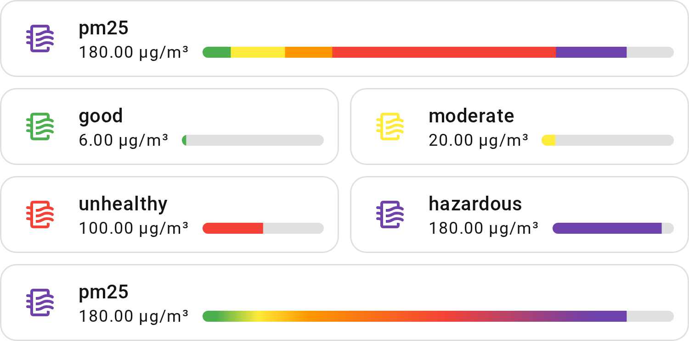
</picture>

The `pm25` configuration defines how different concentrations of fine
particulate matter (PM2.5) are represented using colors and icons. Rather than a
linear gradient, this system categorizes PM2.5 levels into predefined ranges,
each mapped to a specific color for easy interpretation. Each range is visually
represented using the `mdi:air-filter` icon, ensuring a clear and intuitive
display of PM2.5 pollution levels.

<br />
<details>
<summary>Show YAML</summary>

```yaml
type: custom:entity-progress-card
entity: sensor.living_room_pm25
unit: µg/m³
decimal: 0
max_value: 50
theme: pm25
icon_tap_action:
  action: more-info
```

</details>

<details>
<summary>Show ranges</summary>

| **PM2.5 Range (µg/m³)** | **Color Variable**         | **Description**                |
| :---------------------- | :------------------------- | :----------------------------- |
| 0 – 12                  | `var(--green-color)`       | Good air quality               |
| 12 – 35                 | `var(--yellow-color)`      | Moderate air quality           |
| 35 – 55                 | `var(--orange-color)`      | Unhealthy for sensitive groups |
| 55 – 150                | `var(--red-color)`         | Unhealthy air quality          |
| 150 – 200               | `var(--deep-purple-color)` | Very unhealthy air quality     |

</details>
<br />

> [!IMPORTANT]
>
> The information provided in this HA card is based on thresholds from the
> following
> [source](https://support.getawair.com/hc/en-us/articles/19504367520023-Understanding-Awair-Score-and-Air-Quality-Factors-Measured-By-Awair-Element).
> This color code is for informational purposes only and should not be taken as
> professional advice or a standard to follow. It is crucial to consult the
> device's official documentation or current standards for the most accurate and
> up-to-date information. In case of any discrepancy between the information
> provided here and the device's documentation or current standards, the latter
> shall prevail. The lower the value, the better it is generally considered to
> be. With this card you can use `custom_theme` to define your own ranges.

[🔼 Back to top]

<a id="custom-theme"></a>

## Custom theme & `bar_color_mode`

### Custom theme

Your own color zones, e.g. a battery red under 20 %, green up to 80 %, orange
above:

```yaml
type: custom:entity-progress-card
entity: sensor.phone_battery_level
custom_theme:
  - min: 0
    max: 20
    color: red
  - min: 20
    max: 80
    color: green
  - min: 80
    max: 100
    color: orange
```

Each entry of [`custom_theme`](configuration.md#custom_theme) needs `min` and
`max`; a color key (`color`, `bar_color`, `icon_color`) and `icon` are optional.
The bar and the icon can take separate colors instead of one shared `color`:

<details>
<summary>Show YAML</summary>

```yaml
type: custom:entity-progress-card
entity: sensor.phone_battery_level
custom_theme:
  - min: 0
    max: 50
    bar_color: blue
    icon_color: white
  - min: 50
    max: 100
    bar_color: green
    icon_color: green
```

</details>
<br />

> [!NOTE]
>
> The `min`/`max` values are in the entity's native unit. For a sensor whose
> values naturally match the percentage scale (e.g. a battery at 0–100 %), the
> zone boundaries are also 0–100.
>
> Zones don't need to be contiguous or declared in order — see
> [`custom_theme`](configuration.md#custom_theme) in the configuration reference
> for exactly how gaps, overlaps, and incomplete zones behave.
>
> `custom_theme` never changes the default range, `0`–`100`:
>
> - a zone past it (e.g. up to `120` on a `%` sensor) is cut at `100`, not
>   stretched to fit;
> - if your entity's real range is not `0`–`100`, set
>   [`min_value`/`max_value`](configuration.md#max_value) to match your zones.

### `bar_color_mode`

The `bar_color_mode` parameter controls how theme colors are rendered on the
progress bar. It needs a theme: set `theme` or `custom_theme`. Without one, the
bar keeps a single color (this is normal).

| Value          | Description                                                                     |
| :------------- | :------------------------------------------------------------------------------ |
| `auto`         | Default. The bar is filled with the solid color of the current zone.            |
| `segment`      | Each zone is drawn as a distinct colored block up to the current value.         |
| `rainbow`      | A smooth gradient flows across all visible zone colors.                         |
| `rainbow_full` | The track always shows the full gradient; a marker slides to the current value. |

For a battery at 69% with `optimal_when_high`, `segment` shows each zone as a
distinct solid block up to the current value:

```text
[██ red ██][████ orange ████][██████ yellow ██████][████ light-green ▓▓▓]
 0%       20%               40%                   60%                 69%
```

`rainbow` renders the same sensor as a smooth gradient flowing across all
visible zone colors instead.

<br />
<details>
<summary>Show YAML</summary>

```yaml
# segment
type: custom:entity-progress-card
entity: sensor.battery_level
theme: optimal_when_high
bar_color_mode: segment
```

```yaml
# rainbow
type: custom:entity-progress-card
entity: sensor.battery_level
theme: optimal_when_high
bar_color_mode: rainbow
```

</details>
<br />

> [!NOTE]
>
> `bar_color_mode` also works with
> [`center_zero`](configuration.md#center_zero): a signed theme like
> `critical_when_extreme_center` reads as one continuous curve across both arms,
> while a percentage theme reads each arm's own 0–100%: the positive arm shows
> its zones as they are, the negative arm takes the first zone's color
> throughout. A theme in raw units (e.g. `temperature`) is projected onto each
> arm's half of the `min_value`/`max_value` scale. `rainbow_full` in particular
> was built with `center_zero` in mind: each arm gets its own always-full
> gradient, with the marker crossing the visual center at zero. For linear
> themes (e.g. `light`), zone boundaries are derived automatically by splitting
> 0–100% into equal segments (5 levels → 0–20%, 20–40%, …).

[🔼 Back to top]

<a id="token-color"></a>

## Color names

This card leverages Home Assistant’s default color system to seamlessly align
with your active theme preferences.

When defining a color by name, we utilize the standard CSS color palette, which
has evolved over time to include extended color keywords, X11 colors, and SVG
colors (updated in 2022: <https://www.w3.org/TR/css-color-3/#svg-color>).

To maintain a consistent look & feel, we translate color names to Home
Assistant's color definitions. We provide a list of these colors below. If a
color is missing, please do not hesitate to let us know. If you choose a
CSS-compatible color name that is not part of this list, the rendering will be
as defined by the CSS standard.

### Standard color

| **Color Name** | **Mapped CSS Variable**    |
| :------------- | :------------------------- |
| `primary`      | `var(--primary-color)`     |
| `accent`       | `var(--accent-color)`      |
| `red`          | `var(--red-color)`         |
| `pink`         | `var(--pink-color)`        |
| `purple`       | `var(--purple-color)`      |
| `deep-purple`  | `var(--deep-purple-color)` |
| `indigo`       | `var(--indigo-color)`      |
| `blue`         | `var(--blue-color)`        |
| `light-blue`   | `var(--light-blue-color)`  |
| `cyan`         | `var(--cyan-color)`        |
| `teal`         | `var(--teal-color)`        |
| `green`        | `var(--green-color)`       |
| `light-green`  | `var(--light-green-color)` |
| `lime`         | `var(--lime-color)`        |
| `yellow`       | `var(--yellow-color)`      |
| `amber`        | `var(--amber-color)`       |
| `orange`       | `var(--orange-color)`      |
| `deep-orange`  | `var(--deep-orange-color)` |
| `brown`        | `var(--brown-color)`       |
| `light-grey`   | `var(--light-grey-color)`  |
| `grey`         | `var(--grey-color)`        |
| `dark-grey`    | `var(--dark-grey-color)`   |
| `blue-grey`    | `var(--blue-grey-color)`   |
| `black`        | `var(--black-color)`       |
| `white`        | `var(--white-color)`       |
| `disabled`     | `var(--disabled-color)`    |

### Text

| **Color Name**     | **CSS Variable**                  |
| ------------------ | --------------------------------- |
| primary-text       | `var(--primary-text-color)`       |
| secondary-text     | `var(--secondary-text-color)`     |
| text-primary       | `var(--text-primary-color)`       |
| text-light-primary | `var(--text-light-primary-color)` |
| disabled-text      | `var(--disabled-text-color)`      |

### Status

| Color Name | CSS Variable           |
| ---------- | ---------------------- |
| success    | `var(--success-color)` |
| warning    | `var(--warning-color)` |
| error      | `var(--error-color)`   |
| info       | `var(--info-color)`    |

### Interface/UI

| Color Name     | CSS Variable                  |
| -------------- | ----------------------------- |
| dark-primary   | `var(--dark-primary-color)`   |
| darker-primary | `var(--darker-primary-color)` |
| light-primary  | `var(--light-primary-color)`  |
| divider        | `var(--divider-color)`        |
| outline        | `var(--outline-color)`        |
| outline-hover  | `var(--outline-hover-color)`  |
| shadow         | `var(--shadow-color)`         |

### HA State

<details>
<summary>Show all Home Assistant state colors</summary>

Each name maps to Home Assistant's `--<name>-color` variable.

| Color name                                      |
| :---------------------------------------------- |
| `state-active`                                  |
| `state-inactive`                                |
| `state-unavailable`                             |
| `state-alarm_control_panel-armed_away`          |
| `state-alarm_control_panel-armed_custom_bypass` |
| `state-alarm_control_panel-armed_home`          |
| `state-alarm_control_panel-armed_night`         |
| `state-alarm_control_panel-armed_vacation`      |
| `state-alarm_control_panel-arming`              |
| `state-alarm_control_panel-disarming`           |
| `state-alarm_control_panel-pending`             |
| `state-alarm_control_panel-triggered`           |
| `state-alert-off`                               |
| `state-alert-on`                                |
| `state-binary_sensor-active`                    |
| `state-binary_sensor-battery-on`                |
| `state-binary_sensor-carbon_monoxide-on`        |
| `state-binary_sensor-gas-on`                    |
| `state-binary_sensor-glass_break-on`            |
| `state-binary_sensor-heat-on`                   |
| `state-binary_sensor-lock-on`                   |
| `state-binary_sensor-moisture-on`               |
| `state-binary_sensor-problem-on`                |
| `state-binary_sensor-safety-on`                 |
| `state-binary_sensor-smoke-on`                  |
| `state-binary_sensor-sound-on`                  |
| `state-binary_sensor-tamper-on`                 |
| `state-climate-auto`                            |
| `state-climate-cool`                            |
| `state-climate-dry`                             |
| `state-climate-fan_only`                        |
| `state-climate-heat`                            |
| `state-climate-heat-cool`                       |
| `state-cover-active`                            |
| `state-device_tracker-active`                   |
| `state-device_tracker-home`                     |
| `state-fan-active`                              |
| `state-humidifier-on`                           |
| `state-lawn_mower-active`                       |
| `state-lawn_mower-error`                        |
| `state-light-active`                            |
| `state-lock-jammed`                             |
| `state-lock-locked`                             |
| `state-lock-locking`                            |
| `state-lock-open`                               |
| `state-lock-opening`                            |
| `state-lock-unlocked`                           |
| `state-lock-unlocking`                          |
| `state-media_player-active`                     |
| `state-person-active`                           |
| `state-person-home`                             |
| `state-plant-active`                            |
| `state-sensor-battery-high`                     |
| `state-sensor-battery-low`                      |
| `state-sensor-battery-medium`                   |
| `state-siren-active`                            |
| `state-sun-above_horizon`                       |
| `state-sun-below_horizon`                       |
| `state-switch-active`                           |
| `state-update-active`                           |
| `state-vacuum-active`                           |
| `state-vacuum-error`                            |
| `state-valve-active`                            |
| `state-water_heater-eco`                        |
| `state-water_heater-electric`                   |
| `state-water_heater-gas`                        |
| `state-water_heater-heat_pump`                  |
| `state-water_heater-high_demand`                |
| `state-water_heater-performance`                |
| `state-weather-clear_night`                     |
| `state-weather-cloudy`                          |
| `state-weather-exceptional`                     |
| `state-weather-fog`                             |
| `state-weather-hail`                            |
| `state-weather-lightning`                       |
| `state-weather-lightning_rainy`                 |
| `state-weather-partlycloudy`                    |
| `state-weather-pouring`                         |
| `state-weather-rainy`                           |
| `state-weather-snowy`                           |
| `state-weather-snowy_rainy`                     |
| `state-weather-sunny`                           |
| `state-weather-windy`                           |
| `state-weather-windy_variant`                   |

</details>

[🔼 Back to top]

## Style the card with CSS variables (advanced)

<a id="css"></a>

The `--epb-*` variables below restyle the card. Set them in a Home Assistant
theme (all cards using it) or with card_mod / uix (one card).

> [!NOTE]
>
> Nothing here can damage Home Assistant. If a card looks wrong after a change,
> remove the lines you added and reload the page: the card returns to its
> default look.

### Usage

#### Theme

The progress bar background defaults to `var(--divider-color)`, a neutral
semi-transparent color. Depending on your Home Assistant theme, this may lack
contrast or clash with your design.

You can override it globally by defining `--epb-progress-bar-background-color`
directly in your theme YAML — no need to configure each card individually:

```yaml
my_custom_theme:
  # ...
  epb-progress-bar-background-color: 'rgba(255, 255, 255, 0.12)'
```

> [!NOTE]
>
> When declaring CSS variables in a theme YAML file, omit the `--` prefix — Home
> Assistant adds it automatically.

This applies to all cards using that theme.

#### card_mod / uix

All public CSS hooks can also be scoped to a single card using
[card_mod](https://github.com/thomasloven/lovelace-card-mod) - or
[UIX (UI eXtension)](https://github.com/Lint-Free-Technology/uix), a drop-in
replacement built on the same heritage. Same configuration, same result: only
the top-level key changes, `card_mod:` → `uix:` (theme-level keys become
`uix-<thing>(-yaml):` too, if you use those). Everything below works identically
under either key.

```yaml
type: custom:entity-progress-card
entity: sensor.battery
card_mod: # or: uix:
  style: |
    ha-card {
      --epb-card-height: 80px;
      --epb-card-width: 300px;

      --epb-card-border-width: 2px;
      --epb-card-border-color: #ff6600;
      --epb-card-border-radius: 20px;
      --epb-card-border-style: dashed;

      --epb-progress-bar-color: #ff6600;
      --epb-progress-bar-background-color: #333333;
      --epb-icon-and-shape-color: #ff6600;
      --epb-low-watermark-color: #ff0000;
      --epb-high-watermark-color: #00ff00;
      --epb-watermark-opacity: 0.5;
      --epb-watermark-line-size: 3px;
      --epb-zero-mark-width: 2px;

      --epb-progress-bar-size: 60%;
      --epb-progress-bar-radius: 4px;
      --epb-progress-inner-radius: 4px;

      --epb-card-font-family: monospace;
      --epb-name-color: #ffffff;
      --epb-name-font-size: 16px;
      --epb-name-font-weight: 700;
      --epb-name-letter-spacing: 2px;

      --epb-detail-color: #aaaaaa;
      --epb-detail-font-size: 12px;
      --epb-detail-font-weight: 300;
      --epb-detail-letter-spacing: 1px;
    }
```

### CSS hooks

#### Card

| Variable                   | Description                                         | Example     |
| :------------------------- | :-------------------------------------------------- | :---------- |
| `--epb-card-height`        | Card height                                         | `80px`      |
| `--epb-card-width`         | Card width                                          | `300px`     |
| `--epb-card-border-width`  | Border thickness                                    | `2px`       |
| `--epb-card-border-color`  | Border color                                        | `#ff6600`   |
| `--epb-card-border-radius` | Card corner radius                                  | `20px`      |
| `--epb-card-border-style`  | Border style                                        | `dashed`    |
| `--epb-card-font-family`   | Card font family                                    | `monospace` |
| `--epb-spacing`            | Global density: paddings and gaps of the whole card | `6px`       |

#### Icon

| Variable                       | Description                                                                                         | Example   |
| :----------------------------- | :-------------------------------------------------------------------------------------------------- | :-------- |
| `--epb-icon-size`              | Icon size (standard card layout)                                                                    | `28px`    |
| `--epb-shape-size`             | Circular shape size behind the icon                                                                 | `42px`    |
| `--epb-icon-and-shape-color`   | Icon and shape background color, both at once                                                       | `#ff6600` |
| `--epb-icon-color`             | Icon color only, overrides `--epb-icon-and-shape-color` for just the icon                           | `#ff6600` |
| `--epb-icon-shape-color`       | Shape background color only, overrides `--epb-icon-and-shape-color` for just the shape              | `#ff6600` |
| `--epb-icon-shape-hover-color` | Shape background color on hover, for a clickable icon — settable from a theme, no `card_mod` needed | `#ff6600` |
| `--epb-icon-shape-opacity`     | Circular shape opacity behind the icon (`0` removes it entirely, new in 1.6.2)                      | `0`       |
| `--epb-charge-x1`              | `icon_animation: battery_charging` bolt left edge                                                   | `34%`     |
| `--epb-charge-x2`              | `icon_animation: battery_charging` bolt right edge                                                  | `67%`     |
| `--epb-charge-y1`              | `icon_animation: battery_charging` bolt top edge                                                    | `29%`     |

#### Progress Bar

| Variable                              | Description                                                                                    | Example       |
| :------------------------------------ | :--------------------------------------------------------------------------------------------- | :------------ |
| `--epb-progress-transition`           | Bar fill transition (duration/easing, `none` to disable)                                       | `0.2s linear` |
| `--epb-progress-bar-color`            | Progress bar fill color                                                                        | `#ff6600`     |
| `--epb-progress-bar-background-color` | Progress bar background color                                                                  | `#333333`     |
| `--epb-progress-bar-size`             | Forces the bar fill size (overrides computed value)                                            | `60%`         |
| `--epb-progress-bar-radius`           | Progress bar container border radius                                                           | `4px`         |
| `--epb-progress-inner-radius`         | Progress bar inner fill border radius                                                          | `4px`         |
| `--epb-progress-bar-min-width`        | Minimum bar width before it stops shrinking further                                            | `30px`        |
| `--epb-bar-segment-gap`               | `bar_segments` gap between cells (overrides computed value)                                    | `2px`         |
| `--epb-ring-softness`                 | Inner edge softness of the `bar_position: icon` ring (`bar_ring.softness` wins); default `1px` | `0px`         |

#### Marker

| Variable                            | Description                                            | Example   |
| :---------------------------------- | :----------------------------------------------------- | :-------- |
| `--epb-rainbow-marker-color`        | `bar_color_mode: rainbow_full` marker color            | `#ffffff` |
| `--epb-rainbow-marker-opacity`      | `bar_color_mode: rainbow_full` marker opacity          | `1`       |
| `--epb-rainbow-marker-size`         | `bar_color_mode: rainbow_full` marker width            | `5px`     |
| `--epb-rainbow-marker-border-color` | `bar_color_mode: rainbow_full` marker border color     | `#ffffff` |
| `--epb-rainbow-marker-border-width` | `bar_color_mode: rainbow_full` marker border thickness | `1px`     |
| `--epb-zero-mark-width`             | Zero marker thickness                                  | `2px`     |
| `--epb-zero-mark-color`             | Zero marker color                                      | `#ff0000` |

#### Name

| Variable                    | Description         | Example   |
| :-------------------------- | :------------------ | :-------- |
| `--epb-name-color`          | Name color          | `#ffffff` |
| `--epb-name-font-size`      | Name font size      | `16px`    |
| `--epb-name-font-weight`    | Name font weight    | `700`     |
| `--epb-name-letter-spacing` | Name letter spacing | `2px`     |

#### Detail

| Variable                      | Description           | Example   |
| :---------------------------- | :-------------------- | :-------- |
| `--epb-detail-color`          | Detail color          | `#aaaaaa` |
| `--epb-detail-font-size`      | Detail font size      | `12px`    |
| `--epb-detail-font-weight`    | Detail font weight    | `300`     |
| `--epb-detail-letter-spacing` | Detail letter spacing | `1px`     |

#### Trend

| Variable                 | Description                                                                 | Example   |
| :----------------------- | :-------------------------------------------------------------------------- | :-------- |
| `--epb-trend-icon-color` | `trend_indicator` arrow color, overrides the direction's own computed color | `#ff6600` |

#### Watermark

| Variable                       | Description                                                          | Example   |
| :----------------------------- | :------------------------------------------------------------------- | :-------- |
| `--epb-watermark-line-size`    | Line watermark thickness                                             | `3px`     |
| `--epb-watermark-opacity`      | Watermark opacity, both sides (overridden per side by the two below) | `0.5`     |
| `--epb-low-watermark-opacity`  | Low watermark opacity only                                           | `0.5`     |
| `--epb-high-watermark-opacity` | High watermark opacity only                                          | `0.5`     |
| `--epb-low-watermark-color`    | Low watermark color                                                  | `#ff0000` |
| `--epb-high-watermark-color`   | High watermark color                                                 | `#00ff00` |

#### Peak Marker

| Variable                     | Description                        | Example   |
| :--------------------------- | :--------------------------------- | :-------- |
| `--epb-peak-min-color`       | `peak_marker` minimum mark color   | `#00ffff` |
| `--epb-peak-min-opacity`     | `peak_marker` minimum mark opacity | `0.8`     |
| `--epb-peak-max-color`       | `peak_marker` maximum mark color   | `#ff00ff` |
| `--epb-peak-max-opacity`     | `peak_marker` maximum mark opacity | `0.8`     |
| `--epb-peak-average-color`   | `peak_marker` average mark color   | `#ffff00` |
| `--epb-peak-average-opacity` | `peak_marker` average mark opacity | `0.8`     |

#### Alert

| Variable                         | Description                                                                                                                                           | Example   |
| :------------------------------- | :---------------------------------------------------------------------------------------------------------------------------------------------------- | :-------- |
| `--epb-alert-background-opacity` | `alert_when.highlight: background` tint opacity, browsers below the "Full visual effects" tier only (see [Prerequisites](../README.md#prerequisites)) | `0.3`     |
| `--epb-ping-color`               | `ping` ring burst color, shared by `alert_when` (border and label) and `icon_animation: ping`                                                         | `#ff6600` |
| `--epb-ping-spread`              | `ping` ring burst reach at the end of the animation                                                                                                   | `20px`    |

#### Status Label

| Variable                       | Description                          | Example   |
| :----------------------------- | :----------------------------------- | :-------- |
| `--epb-label-color`            | `status_label` pill text color       | `#ffffff` |
| `--epb-label-background-color` | `status_label` pill background color | `#333333` |
| `--epb-label-border-color`     | `status_label` pill border color     | `#ff6600` |

#### Icon and shape color

The shape (the circular background behind the icon) has its own opacity,
independent of `--epb-icon-and-shape-color`/`--epb-icon-shape-color` — 20% at
rest, 35% on hover for a clickable icon (`ha-tile-icon`'s own numbers). CSS
`opacity` multiplies with whatever alpha the color itself already carries, so an
`rgba(...)` shape color and that built-in opacity **compose**: a
`rgba(255, 102, 0, 0.3)` shape color actually renders at roughly 0.3 × 20% ≈ 6%
visible opacity at rest, not 30%.

If you're picking the alpha yourself, set `--epb-icon-shape-opacity: 1` too so
your `rgba()` value is the only transparency in effect:

```yaml
card_mod: # or: uix:
  style: |
    ha-card {
      --epb-icon-shape-color: rgba(255, 102, 0, 0.3);
      --epb-icon-shape-opacity: 1;
    }
```

Doing that also turns off the built-in hover brighten (20% → 35%), since it's
driven by that same opacity. `--epb-icon-shape-hover-color` restores a hover
effect for a clickable icon without `card_mod` — a plain value in your theme
YAML, since a theme can't declare a `:hover` selector itself:

```yaml
my_custom_theme:
  # ...
  epb-icon-shape-color: 'rgba(255, 102, 0, 0.3)'
  epb-icon-shape-opacity: 1
  epb-icon-shape-hover-color: 'rgba(255, 102, 0, 0.5)'
```

The same thing also works from `card_mod`, scoped to a single card. Its `style:`
is injected straight into the card's own shadow root, so it can also target
`.shape` directly if you need a real `:hover` rule instead — shown in the
[DOM tree](#dom) below:

```yaml
card_mod: # or: uix:
  style: |
    ha-card {
      --epb-icon-shape-color: rgba(255, 102, 0, 0.3);
      --epb-icon-shape-opacity: 1;
    }
    .shape:hover {
      --epb-icon-shape-color: rgba(255, 102, 0, 0.5);
    }
```

> [!NOTE]
>
> Unlike the `--epb-*` variables, `.shape` is an internal class name, not a
> versioned public hook — see the
> [Class Name Updates & Migration Guide](#class-name-migration) if it's ever
> renamed in a future release.

[🔼 Back to top]

<a id="card-mod-and-card-structure"></a>

## card_mod / uix and card structure

<a id="class-name-migration"></a>

### Class Name Updates & Migration Guide (v1.6.0+)

This project has evolved with new use cases, which means that the original class
names needed to be revisited. The goal of this update is to simplify the
identification of elements within the cards, making it easier to understand and
maintain.

These changes also prepare the codebase for future releases, ensuring
consistency and flexibility for upcoming features.

To help you transition to this new class naming scheme, you will find the table
below, which shows the mapping between the old and new class names. This should
guide you in updating your custom card modifications.

| **Old Class**                    | **New Class**            | **Notes / Usage**                                                                               |
| -------------------------------- | ------------------------ | ----------------------------------------------------------------------------------------------- |
| `name-group`                     | `name`                   | Main container for the name block                                                               |
| `name-combined`                  | `name-value`             | Displays the combined main and extra name                                                       |
| `name`                           | `name-main`              | Main name text                                                                                  |
| `name-custom-info`               | `name-extra`             | Extra name info, appended after main name                                                       |
| `secondary-info-detail-group`    | `secondary-info-wrapper` | Container for secondary info (state/progress/custom)                                            |
| `secondary-info-detail-combined` | `secondary-info-value`   | Displays main + extra secondary info — now a `<div>`, was a `<span>`                            |
| `state-and-progress-info`        | `secondary-info-main`    | Main secondary info (was progress/state)                                                        |
| `secondary-info-custom-info`     | `secondary-info-extra-1` | Extra secondary info, line 1 (was custom info)                                                  |
| —                                | `secondary-info-extra-2` | Extra secondary info, line 2 — only exists with [`multiline: true`](configuration.md#multiline) |
| `progress-bar-container`         | `bar-container`          | Progress bar wrapper                                                                            |
| `progress-bar-inner`             | `inner`                  | Single inner bar element (positive/negative unified)                                            |
| `progress-bar-low-zero`          | `zero`                   | Zero mark for center-zero bars                                                                  |
| `progress-bar-low-wm`            | `low`                    | Low watermark marker                                                                            |
| `progress-bar-high-wm`           | `high`                   | High watermark marker                                                                           |

[🔼 Back to top]

### DOM

#### Card

```text
ha-card.entity-progress-card...
 ├─ ha-ripple
 ├─ div.container
 │   ├─ div.trend-indicator (optional)
 │   │   └─ ha-icon.trend-icon
 │   ├─ div.icon-section
 │   │   ├─ shape.shape
 │   │   │   ├─ ha-ripple
 │   │   │   └─ div.icon
 │   │   │       └─ ha-state-icon
 │   │   └─ div.badge (optional)
 │   │       └─ ha-icon.badge-icon
 │   └─ div.content-section
 │       ├─ div.name
 │       │   └─ div.ellipsis-wrapper
 │       │       └─ span.name-value
 │       │           ├─ span.name-main
 │       │           └─ span.name-extra (optional)
 │       └─ div.secondary-info
 │           └─ div.secondary-info-wrapper
 │               └─ div.ellipsis-wrapper
 │                   └─ div.secondary-info-value
 │                       ├─ span.secondary-info-extra-1 (optional)
 │                       └─ span.secondary-info-main
 └─ div.top-container / div.bottom-container / div.below-container (depends on barPosition)
     └─ div.bar-container
         └─ div.progress-bar.default / center-zero (depends on bar type)
             ├─ div.inner
             ├─ div.low.watermark.mark.wm-<type>
             ├─ div.high.watermark.mark.wm-<type>
             ├─ div.peak-min.watermark.mark.wm-<type> (Card only)
             ├─ div.peak-max.watermark.mark.wm-<type> (Card only)
             ├─ div.peak-avg.watermark.mark.wm-<type> (Card only)
             └─ div.zero.mark (if center-zero)
```

Every mark carries its own shape class — `wm-blended`, `wm-area`, `wm-striped`,
`wm-line`, `wm-round` or `wm-triangle` — matching that mark's own
[`type`](configuration.md#watermark). One rule per shape styles every mark,
watermark and `peak_marker` alike.

With [`multiline: true`](configuration.md#multiline),
`div.secondary-info-wrapper` looks like this instead — two independent
single-line boxes rather than one shared line:

```text
div.secondary-info-wrapper
 ├─ div.ellipsis-wrapper.secondary-info-line-1
 │   └─ div.secondary-info-value
 │       └─ span.secondary-info-extra-1
 └─ div.ellipsis-wrapper.secondary-info-line-2
     └─ div.secondary-info-value
         ├─ span.secondary-info-extra-2 (optional)
         └─ span.secondary-info-main
```

> [!NOTE]
>
> The two multiline lines are sized to fit within the same total height as one
> standard line, so their font size and line height are fixed and don't follow
> `--epb-detail-font-size`. Color, weight and letter spacing still do
> (`--epb-detail-color`, `--epb-detail-font-weight`,
> `--epb-detail-letter-spacing`).

With [`content_order`](configuration.md#content_order), `div.content-section`
holds one `div.content-line` per line instead:

```text
div.content-section
 ├─ div.content-line.lead (first line; none on a single_line row)
 │   ├─ div.content-group (consecutive texts, one ellipsis)
 │   │   ├─ span.name-main[data-block=name]
 │   │   └─ span.name-extra[data-block=name_info]
 │   └─ div.content-group.value-end (a value closing the line)
 │       └─ span.secondary-info-main[data-block=value]
 └─ div.content-line.with-bar
     ├─ div.content-group
     │   ├─ span.secondary-info-extra-1[data-block=info]
     │   └─ span.secondary-info-state[data-block=state_content]
     └─ div.bar-container
```

> [!NOTE]
>
> The text variables follow the line, not the item: `--epb-name-*` style the
> first line, `--epb-detail-*` every other line, whatever they hold.

#### Template

```text
ha-card...
 ├─ ha-ripple
 ├─ div.container
 │   ├─ div.trend-indicator (optional)
 │   │   └─ ha-icon.trend-icon
 │   ├─ div.icon-section
 │   │   ├─ shape.shape
 │   │   │   ├─ ha-ripple
 │   │   │   └─ div.icon
 │   │   │       └─ ha-state-icon
 │   │   └─ div.badge (optional)
 │   │       └─ ha-icon.badge-icon
 │   └─ div.content-section
 │       ├─ div.name
 │       │   └─ div.ellipsis-wrapper
 │       │       └─ span.name-value
 │       │           ├─ span.name-main
 │       │           └─ span.name-extra (optional)
 │       └─ div.secondary-info
 │           └─ div.secondary-info-wrapper
 │               └─ div.ellipsis-wrapper
 │                   └─ div.secondary-info-value
 │                       └─ span.secondary-info-extra-1
 └─ div.top-container / div.bottom-container / div.below-container (if barPosition)
     └─ div.bar-container
         └─ div.progress-bar.default / center-zero
             ├─ div.inner
             ├─ div.low.watermark.mark.wm-<type>
             ├─ div.high.watermark.mark.wm-<type>
             ├─ div.peak-min.watermark.mark (always present, never shown - peak_marker is Card only)
             ├─ div.peak-max.watermark.mark (always present, never shown - peak_marker is Card only)
             ├─ div.peak-avg.watermark.mark (always present, never shown - peak_marker is Card only)
             └─ div.zero.mark (if center-zero)
```

With [`multiline: true`](configuration.md#multiline),
`div.secondary-info-wrapper` looks like this instead. Template cards never have
a `secondary-info-main` span (their value comes through
[`percent`](configuration.md#percent-jinja)/[`secondary`](configuration.md#secondary-jinja)
instead), so unlike the standard card, line 2 is `secondary-info-extra-2` alone:

```text
div.secondary-info-wrapper
 ├─ div.ellipsis-wrapper.secondary-info-line-1
 │   └─ div.secondary-info-value
 │       └─ span.secondary-info-extra-1
 └─ div.ellipsis-wrapper.secondary-info-line-2
     └─ div.secondary-info-value
         └─ span.secondary-info-extra-2
```

#### Badge

```text
ha-card...
 ├─ div.container
 │   ├─ div.icon-section
 │   │   └─ shape.shape
 │   │       ├─ ha-ripple
 │   │       └─ div.icon
 │   │           └─ ha-state-icon
 │   └─ div.content-section
 │       ├─ div.name
 │       │   └─ div.ellipsis-wrapper
 │       │       └─ span.name-value
 │       │           ├─ span.name-main
 │       │           └─ span.name-extra (optional)
 │       └─ div.secondary-info
 │           └─ div.secondary-info-wrapper
 │               └─ div.ellipsis-wrapper
 │                   └─ div.secondary-info-value
 │                       ├─ span.secondary-info-extra-1 (optional)
 │                       └─ span.secondary-info-main

```

`multiline` is not available on badges — the row is too small for a second line
(see [`multiline`](configuration.md#multiline)).

#### Center-Zero / Vertical Bars (Additional Variants)

```text
ha-card...
 ├─ div.container
 │   ├─ div.icon-section
 │   └─ div.content-section
 │       ├─ div.name
 │       │   └─ span.name-value
 │       └─ div.secondary-info
 │           └─ div.secondary-info-value
 └─ div.bar-container.vertical / top / bottom / below
     └─ div.progress-bar.center-zero
         ├─ div.bar-half.negative-zone
         │   └─ div.inner.negative
         ├─ div.bar-half.positive-zone
         │   └─ div.inner.positive
         ├─ div.low.watermark.mark.wm-<type>
         ├─ div.high.watermark.mark.wm-<type>
         ├─ div.peak-min.watermark.mark.wm-<type> (Card only)
         ├─ div.peak-max.watermark.mark.wm-<type> (Card only)
         ├─ div.peak-avg.watermark.mark.wm-<type> (Card only)
         └─ div.zero.mark
```

[🔼 Back to top]

## Card sizing

<a id="card-sizing"></a>

In most dashboards there is nothing to do: the card sizes itself. Read on only
if it looks too tall or too short; the [last section](#embedded) has a recipe
that shrinks it to its content.

<details>
<summary>How the card picks its height</summary>

The card adapts to whatever height (or lack of one) its parent gives it. Three
CSS layers work together:

- **`getGridOptions()`** (Card/Template only, not Badge) tells Home Assistant's
  own Sections grid how many rows to reserve - a plain integer count, not a
  pixel value. HA turns that into the actual cell size.
- **`min-height`** is the floor used everywhere that grid reservation doesn't
  apply (Masonry, embedded in another card) - computed from the exact same row
  count, translated into Home Assistant's own row-height/gap CSS variables
  rather than a hardcoded pixel value, so a theme customizing those is followed
  automatically.
- **`height`** is `100%` by default - fills whatever the parent actually gives
  it.

Both the grid row count and the min-height floor come from the same calculation
(`ViewCore.minGridRows` if you're reading the source): 1 row by default
(horizontal) or 2 (vertical), +1 more for `bar_size: xlarge` or
`bar_position: below`, and capped to 1 row entirely when the icon is hidden
(hiding it only ever changes the base row count, never whether a large bar still
needs its own extra row on top - see [issue #133]). Also capped to 1 row for
`layout: vertical` + `bar_position: top`/`bottom`/`background` once `name` and
`secondary_info` are both hidden - the bar overlays the icon row there instead
of needing one of its own, same as
[`density: compact`](configuration.md#density) always resolves to on that
layout.

</details>

### In a Sections view

`getGridOptions()` reserves the right number of rows; the card's own
`min-height` (see [`height`](configuration.md#height)) reads HA's own
`--row-size` first, so it lands on the exact same pixel height Sections reserved
for it. This is the default, "just works" case - nothing to configure.

### In a Masonry view

Masonry doesn't call `getGridOptions()` at all, and its cards have no explicit
parent height. The card falls back to its `min-height` floor (the same row-based
calculation above, expressed in real pixels via
`--ha-section-grid-row-height`/`--ha-section-grid-row-gap`). If the content
genuinely needs more room than that floor (wrapped text, a larger accessibility
text-size setting), the card grows past it - `min-height` is a floor, not a
fixed size, precisely so that can happen instead of clipping.

### Inside another Lovelace card

An explicit [`height`](configuration.md#height) always wins outright as the
card's exact size, in every container below - it doesn't depend on the card
detecting anything about its surroundings. What actually varies per container is
what happens **without** an explicit `height` (does the `min-height` floor land
on something sensible?), and whether the container gets **auto-detected** to
drop the card's own frame/background for you (see
[`frameless`](configuration.md#frameless)) - or you have to set
`frameless: true` yourself.

✅ handled for you · ➖ partly, see the cell · ⚠️ with limits · ❌ not
detected.

| Card                                                                                                  | Default sizing (no `height` set) | Frameless auto-detected          | Notes                                                                       |
| :---------------------------------------------------------------------------------------------------- | :------------------------------- | :------------------------------- | :-------------------------------------------------------------------------- |
| `entities`                                                                                            | ✅ Content-sized                  | ✅ Yes                            | No config needed.                                                           |
| `picture-elements`                                                                                    | ➖ Width only                     | ❌ No - set `frameless: true`     | `min_width` defaults to 200px; height is not special-cased.                 |
| `vertical-stack-in-card`                                                                              | ➖ Masonry-style floor            | ✅ Yes                            | Frame dropped as in `entities`.                                             |
| `vertical-stack`                                                                                      | ➖ Masonry-style floor            | ❌ No - set `frameless: true`     | One card per row.                                                           |
| `horizontal-stack`                                                                                    | ⚠️ Reliable in Masonry only      | ❌ No - set `frameless: true`     | In Sections it can look shorter than a card placed directly in the section. |
| `grid`                                                                                                | ⚠️ Depends on `square`           | ❌ No - set `frameless: true`     | `square: true` (default) forces square cells, even over `height`.           |
| `custom:combined-card` ([catdad-experiments](https://github.com/catdad-experiments/ha-utility-cards)) | ➖ Masonry-style floor            | ❌ No - set `frameless: true`     | Behaves like the native stacks it uses inside.                              |
| `custom:button-card` (custom field)                                                                   | ✅ Content-sized                  | ❌ No - set `frameless: true`     | See the recipe [below](#embedded) (issue #129).                             |
| `custom:auto-entities`                                                                                | ➖ Depends on the outer container | ➖ Depends on the outer container | Each generated card follows the outer container's rules.                    |
| `custom:layout-card` (thomasloven)                                                                    | ➖ Masonry-style floor            | ❌ No - set `frameless: true`     | Natural height in every layout mode.                                        |

In `grid`, `square: false` behaves like everywhere else: Masonry-style
floor without `height`, exact size with it. `custom:combined-card` gets no
`type-*` class (only [card_mod] adds them, and not to stack cards), so its
frame is never dropped for you.

<a id="embedded"></a>

### Embedded in another card (`custom:button-card`, a custom field, ...)

Same mechanics as Masonry - the card's `min-height` floor is the effective size
unless the wrapper stretches its children to some ambient height (common with
`custom:button-card` fields), in which case the card fills that instead, which
can look larger than expected if nothing else on the card needs it (see
[issue \#129](https://github.com/francois-le-ko4la/lovelace-entity-progress-card/issues/129)).

For a card that shrinks fully to its content regardless of what the wrapper
does, combine:

```yaml
type: custom:entity-progress-card
height: auto
marginless: true
frameless: true
```

- [`height: auto`](configuration.md#height) - forces content-sized height
  instead of `100%`, even where the parent _would_ otherwise stretch it.
- [`marginless: true`](configuration.md#marginless) - drops the min-height floor
  entirely (`unset`) and removes the card's own padding/margin.
- [`frameless: true`](configuration.md#frameless) - drops the border/
  background, useful when the wrapper already provides its own frame.

[issue #133]:
  https://github.com/francois-le-ko4la/lovelace-entity-progress-card/issues/133
[card_mod]: https://github.com/thomasloven/lovelace-card-mod

[🔼 Back to top]

[🔼 Back to top]: #top

